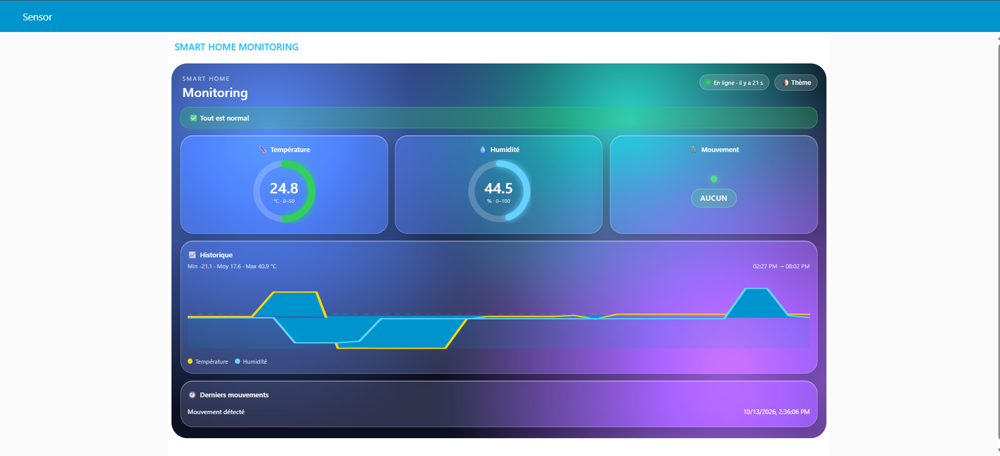
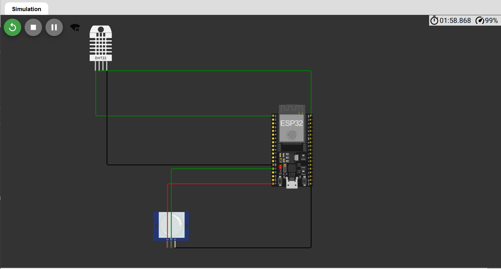

# Smart Home Monitoring – Dashboard IoT temps réel

Système de surveillance domestique complet, du capteur jusqu'au tableau de bord : un ESP32 (simulé sur Wokwi) mesure la température, l'humidité et le mouvement, publie en MQTT, puis Node-RED traite les données et les affiche dans une interface web personnalisée au style *glassmorphism* (inspirée de visionOS), avec historique, alertes et notifications mobiles.



## Fonctionnalités

- Mesure de la température et de l'humidité (DHT22) et détection de mouvement (PIR) sur ESP32
- Publication JSON toutes les 5 s via MQTT (broker HiveMQ), avec reconnexion automatique
- Validation et parsing des données, gestion des messages invalides
- **Historique glissant** des 120 dernières mesures avec courbe, min / moyenne / max
- **Système d'alertes** à seuils (température et humidité) avec anti-spam (cooldown de 10 min)
- **Notifications push sur mobile** via ntfy
- **Journal des événements** de mouvement
- **Statut du capteur** en ligne / hors ligne (aucune donnée reçue depuis plus de 30 s)
- Mode clair / sombre mémorisé dans le navigateur
- Interface responsive (mobile et bureau)

## Architecture

Format du message publié par le capteur :

```json
{"temperature": 23.10, "humidity": 66.50, "motion": "NONE"}
```

`motion` vaut `"NONE"` ou `"DETECTED"`.

## Simulation du capteur (Wokwi)

ESP32 + DHT22 (température / humidité) + capteur PIR (mouvement), simulés sur [Wokwi]([https://wokwi.com/](https://wokwi.com/projects/476346247244546049)).



## Démo sans installation

Ouvrez `demo.html` dans un navigateur : le dashboard fonctionne avec des données simulées, sans Node-RED ni capteur.

## Contenu du dépôt

| Fichier | Rôle |
|---|---|
| `wokwi/sketch.ino` | Code de l'ESP32 (lecture des capteurs, publication MQTT) |
| `flow.json` | Export du flow Node-RED (à importer) |
| `analyse.js` | Code du nœud function : historique, statistiques, alertes |
| `dashboard.html` | Code du nœud ui_template : interface du dashboard |
| `demo.html` | Démo autonome avec données simulées |
| `docs/` | Captures d'écran (dashboard et câblage Wokwi) |

## Réglage des seuils d'alerte

```js
const T_HIGH = 30, T_LOW = 10;   // température (°C)
const H_HIGH = 80, H_LOW = 25;   // humidité (%)
const COOLDOWN = 10 * 60 * 1000; // anti-spam : 10 minutes
```

## Technologies

ESP32 (Arduino C++) · Wokwi · MQTT (HiveMQ) · Node-RED · JSON · JavaScript · HTML/CSS (SVG, backdrop-filter) · AngularJS (ui_template) · ntfy

## Pistes d'amélioration

- Persistance de l'historique (InfluxDB + Grafana)
- Commande d'un actionneur (relais, LED) depuis le dashboard
- Authentification MQTT (TLS + identifiants)
- Déploiement sur Raspberry Pi avec Docker
