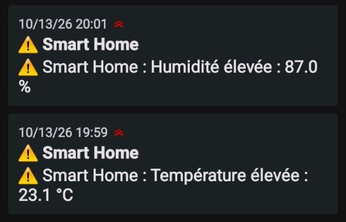

# Smart Home Monitoring – Real-Time IoT Dashboard

Complete home monitoring system, from the sensor to the dashboard: an ESP32 (simulated on Wokwi) measures temperature, humidity and motion, publishes over MQTT, then Node-RED processes the data and displays it in a custom web interface in *glassmorphism* style (inspired by visionOS), with history, alerts and mobile notifications.


## Features

- Temperature and humidity measurement (DHT22) and motion detection (PIR) on ESP32
- JSON publishing every 5 s via MQTT (HiveMQ broker), with automatic reconnection
- Data validation and parsing, handling of invalid messages
- **Rolling history** of the last 120 measurements with a chart, min / average / max
- **Threshold alert system** (temperature and humidity) with anti-spam (10 min cooldown)
- **Mobile push notifications** via ntfy
- **Motion event log**
- **Sensor status** online / offline (no data received for more than 30 s)
- Light / dark mode remembered in the browser
- Responsive interface (mobile and desktop)

## Architecture

Format of the message published by the sensor:

```json
{"temperature": 23.10, "humidity": 66.50, "motion": "NONE"}
```

`motion` is `"NONE"` or `"DETECTED"`.

## Sensor Simulation (Wokwi)

ESP32 + DHT22 (temperature / humidity) + PIR sensor (motion), simulated on [Wokwi]([https://wokwi.com/](https://wokwi.com/projects/476346247244546049)).


## Demo Without Installation

Open `demo.html` in a browser: the dashboard works with simulated data, without Node-RED or a sensor.

## Repository Contents

| File | Role |
|---|---|
| `wokwi/sketch.ino` | ESP32 code (sensor reading, MQTT publishing) |
| `flow.json` | Node-RED flow export (to import) |
| `analyse.js` | Function node code: history, statistics, alerts |
| `dashboard.html` | ui_template node code: dashboard interface |
| `demo.html` | Standalone demo with simulated data |
| `docs/` | Screenshots (dashboard and Wokwi wiring) |

## Mobile Notifications

When a threshold is exceeded, a push notification is sent to the phone via ntfy (with a 10-minute anti-spam delay between two identical alerts).



*Screenshot taken during a test, with the thresholds temporarily lowered to trigger the alerts.*

## Alert Threshold Settings

```js
const T_HIGH = 30, T_LOW = 10;   // temperature (°C)
const H_HIGH = 80, H_LOW = 25;   // humidity (%)
const COOLDOWN = 10 * 60 * 1000; // anti-spam: 10 minutes
```

## Technologies

ESP32 (Arduino C++) · Wokwi · MQTT (HiveMQ) · Node-RED · JSON · JavaScript · HTML/CSS (SVG, backdrop-filter) · AngularJS (ui_template) · ntfy

## Improvement Ideas

- History persistence (InfluxDB + Grafana)
- Actuator control (relay, LED) from the dashboard
- MQTT authentication (TLS + credentials)
- Deployment on Raspberry Pi with Docker
